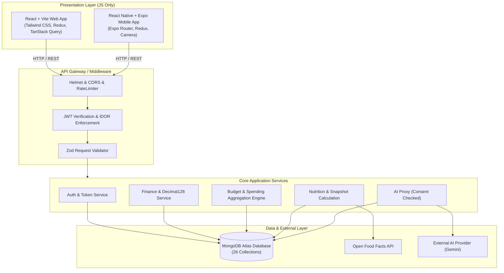

# LifeTrack System Architecture

## 1. High-Level Monorepo Topology
```
lifetrack/
├── backend/            # Node.js + Express (ES Modules) REST API
├── frontend/           # React + Vite Web Client (Tailwind CSS, Redux)
├── mobile/             # React Native + Expo Mobile Client
└── documentation/      # Architectural, DB, and API documentation
```

---

## 2. Architecture Diagram (Mermaid)



---

## 3. Key Design Patterns & Guarantees
1. **Financial Immutability & Precision**: Monetary amounts use `Decimal128` to maintain financial precision and eliminate floating-point arithmetic flaws.
2. **Deterministic Nutrition Calculations**: Historical meal logs preserve immutable nutritional snapshots at the moment of entry.
3. **AI Consent Gateway**: Financial data is never transmitted to AI endpoints unless validated against the `userConsents` collection.
4. **Strict IDOR Mitigation**: All operational endpoints extract the authenticated user identity directly from the verified JWT payload rather than trusting path or body parameters.

---

## 4. Budget Calculation Engine (Phase 3B)
1. **Scope Separation**:
   - `CATEGORY`: Evaluates only `EXPENSE` transactions belonging to the designated category within the budget period.
   - `OVERALL`: Evaluates all qualifying `EXPENSE` transactions for the user within the budget period.
2. **Double-Counting Prevention**:
   - The summary endpoint distinguishes between individual budget spending sums and the user's distinct monthly expenses, preventing category and overall budgets from falsely inflating calculated totals.
3. **Strict Expense Exclusivity**:
   - `INCOME` transactions are strictly excluded from spending calculations.
4. **Calculation Rules**:
   - `remainingAmount = budgetAmount - spentAmount` (allows negative balances when exceeded).
   - `percentageUsed = (spentAmount / budgetAmount) * 100` (uncapped to accurately surface overspending).
   - `thresholdReached = percentageUsed >= alertThreshold`.
   - `exceededBudget = spentAmount > budgetAmount`.
   - Visual states: `NORMAL`, `WARNING`, `EXCEEDED`, `EXPIRED`.
