# LifeTrack Database Design Document (MongoDB)

## 1. Overview & Architectural Philosophy
LifeTrack uses **MongoDB** with **Mongoose ODM** adhering strictly to:
- **No SQL / No TypeScript / JavaScript ES Modules exclusively**.
- **Financial Precision**: All monetary values are handled via `Decimal128` or integer minor units to eliminate IEEE 754 floating-point inaccuracies.
- **Nutrition Snapshot Preservation**: Every meal entry stores a frozen snapshot of nutritional calculations at log time to preserve historical integrity.
- **User-Level Data Isolation**: Strict user-ownership enforcement via `ObjectId` references to eliminate Insecure Direct Object References (IDOR).
- **Indexing Strategy**: Single and compound indexes tailored for time-series lookups, text search, and periodic aggregations.

---

## 2. Entity-Relationship Diagram (Mermaid)

```mermaid
erDiagram
    User ||--o{ RefreshToken : "owns"
    User ||--|| UserPreferences : "configures"
    User ||--o{ UserConsent : "authorizes"
    User ||--|| NutritionProfile : "maintains"
    
    User ||--o{ FinanceCategory : "creates"
    User ||--o{ Transaction : "records"
    FinanceCategory ||--o{ Transaction : "categorizes"
    User ||--o{ Budget : "defines"
    User ||--o{ SavingsGoal : "tracks"
    User ||--o{ RecurringTransaction : "schedules"
    
    User ||--o{ FoodItem : "custom_creates"
    User ||--o{ MealLog : "logs"
    FoodItem ||--o{ MealLog : "references"
    User ||--o{ FoodAllergy : "suffers"
    User ||--o{ DietaryRestriction : "follows"
    User ||--o{ DietPlan : "follows"
    User ||--o{ WaterLog : "records"
    User ||--o{ WeightLog : "tracks"
    User ||--o{ ActivityLog : "logs"
    
    User ||--o{ GroceryList : "creates"
    GroceryList ||--o{ GroceryItem : "contains"
    FoodItem ||--o{ GroceryItem : "specifies"
    
    User ||--o{ AIConversation : "participates"
    AIConversation ||--o{ AIMessage : "contains"
    User ||--o{ AIRecommendation : "receives"
    
    User ||--o{ Notification : "receives"
    User ||--o{ DeviceToken : "registers"
    User ||--o{ ReportJob : "requests"
```

---

## 3. Detailed Collections Specification

### 3.1 Authentication & User Management
1. **`users`**
   - Fields: `_id`, `firstName`, `lastName`, `email` (unique index), `password` (bcrypt hash, excluded in queries), `role` (`user` | `admin`), `isActive`, `isEmailVerified`, `avatar`, `phone`, `emailVerificationToken`, `emailVerificationExpires`, `passwordResetToken`, `passwordResetExpires`, `passwordChangedAt`, `lastLoginAt`, `loginCount`, `onboardingCompleted`, `onboardingStep`, `createdAt`, `updatedAt`.
   - Indexes: `{ email: 1 }` (unique), `{ role: 1 }`, `{ createdAt: -1 }`.

2. **`refreshTokens`**
   - Fields: `_id`, `user` (ref: User), `tokenHash`, `deviceInfo` (userAgent, ip, platform), `expiresAt`, `isRevoked`, `revokedAt`, `replacedByToken`, `createdAt`.
   - Indexes: `{ tokenHash: 1 }` (unique), `{ user: 1, isRevoked: 1 }`, `{ expiresAt: 1 }` (TTL).

3. **`userPreferences`**
   - Fields: `_id`, `user` (ref: User, unique), `theme` (`light` | `dark` | `system`), `language`, `currency` (default: `INR`), `notifications` (emailDigest, pushEnabled, mealReminders, budgetAlerts, waterReminders, weeklyReport), `nutritionDisplay`, `financeDisplay`, `mealReminderTimes`.

4. **`userConsents`**
   - Fields: `_id`, `user` (ref: User), `consentType` (`ai_diet_analysis`, `ai_finance_insights`, `ai_combined_insights`, `data_analytics`, etc.), `granted`, `grantedAt`, `revokedAt`, `ipAddress`, `userAgent`, `version`.
   - Indexes: `{ user: 1, consentType: 1 }`.

### 3.2 Finance Management
5. **`financeCategories`**
   - Fields: `_id`, `user` (nullable for system categories), `name`, `type` (`income` | `expense` | `both`), `icon`, `color`, `isSystem`, `isActive`, `parentCategory`, `sortOrder`.
   - Indexes: `{ user: 1, type: 1 }`, `{ isSystem: 1, type: 1 }`.

6. **`transactions`**
   - Fields: `_id`, `user`, `type` (`income` | `expense` | `transfer`), `amount` (Decimal128), `currency`, `category` (ref: FinanceCategory), `description`, `notes`, `date`, `paymentMethod`, `tags`, `attachments`, `isRecurring`, `recurringTransactionId`, `isFoodExpense`, `merchantName`, `location`.
   - Indexes: `{ user: 1, date: -1 }`, `{ user: 1, type: 1, date: -1 }`, `{ user: 1, category: 1 }`, Text: `{ description: "text", merchantName: "text", notes: "text" }`.

7. **`budgets`**
   - Fields: `_id`, `user`, `name`, `period` (`weekly` | `monthly` | `yearly`), `periodStartDate`, `periodEndDate`, `totalBudget` (Decimal128), `categoryLimits` (`[{ category, limit (Decimal128), alertThreshold }]`), `isActive`, `alertsEnabled`.
   - Indexes: `{ user: 1, period: 1, periodStartDate: -1 }`, `{ user: 1, periodStartDate: 1, periodEndDate: 1 }`.

8. **`savingsGoals`**
   - Fields: `_id`, `user`, `name`, `description`, `targetAmount` (Decimal128), `currentAmount` (Decimal128), `targetDate`, `category`, `icon`, `color`, `isCompleted`, `contributions` (`[{ amount (Decimal128), note, date }]`).
   - Indexes: `{ user: 1, isActive: 1 }`, `{ user: 1, targetDate: 1 }`.

9. **`recurringTransactions`**
   - Fields: `_id`, `user`, `type`, `amount` (Decimal128), `category`, `description`, `frequency` (`daily`|`weekly`|`biweekly`|`monthly`|`quarterly`|`yearly`), `startDate`, `endDate`, `nextDueDate`, `isActive`.
   - Indexes: `{ nextDueDate: 1, isActive: 1 }`, `{ user: 1, isActive: 1 }`.

### 3.3 Nutrition, Sugar & Diet Management
10. **`nutritionProfiles`**
    - Fields: `_id`, `user` (unique), `dateOfBirth`, `gender`, `heightCm`, `weightKg`, `goalWeight`, `weightGoal`, `activityLevel`, `dailyCalorieTarget`, `dailyProteinTargetG`, `dailyCarbTargetG`, `dailyFatTargetG`, `dailySugarTargetG`, `dailyAddedSugarTargetG`, `dailyWaterTargetMl`, `dietType`, `cuisinePreferences`.

11. **`foodItems`**
    - Fields: `_id`, `name`, `nameLocal` (e.g. Tamil/Hindi script name), `brand`, `barcode`, `source` (`system` | `open_food_facts` | `user_created` | `curated_indian`), `openFoodFactsId`, `createdBy`, `isPublic`, `nutritionPer100` (calories, protein, carbs, fat, fiber, sugar, addedSugar, saturatedFat, sodium, etc.), `servingSizes`, `category`, `cuisine`, `isVerified`.
    - Indexes: Text: `{ name: "text", brand: "text", nameLocal: "text", tags: "text" }`, `{ barcode: 1 }`, `{ source: 1 }`.

12. **`mealLogs`**
    - Fields: `_id`, `user`, `foodItem`, `logDate`, `mealType` (`breakfast` | `lunch` | `dinner` | `snack`), `servingSizeDescription`, `servingQuantity`, `consumedGrams`, `nutritionSnapshot` (immutable calculated snapshot: calories, protein, carbs, fat, sugar, addedSugar, etc.), `foodNameSnapshot`, `isFavorite`, `loggedAt`.
    - Formula: `nutrientConsumed = (nutritionPer100 * consumedGrams) / 100`.
    - Indexes: `{ user: 1, logDate: -1 }`, `{ user: 1, logDate: 1, mealType: 1 }`.

13. **`waterLogs`**: `{ user, logDate, amountMl, source, loggedAt }`. Index: `{ user: 1, logDate: -1 }`.
14. **`weightLogs`**: `{ user, weightKg, bmi, logDate, measurements }`. Index: `{ user: 1, logDate: -1 }`.
15. **`activityLogs`**: `{ user, activityName, category, durationMinutes, caloriesBurned, intensityLevel, logDate }`. Index: `{ user: 1, logDate: -1 }`.
16. **`dietPlans`**: `{ user, name, planType, goalType, dietType, cuisineType, targetCalories, days: [{ dayOfWeek, meals }] }`. Index: `{ user: 1, isActive: 1 }`.
17. **`foodAllergies`**: `{ user, allergen, severity, symptoms, diagnosedBy }`. Unique Index: `{ user: 1, allergen: 1 }`.
18. **`dietaryRestrictions`**: `{ user, restrictionType, customName, reason }`. Index: `{ user: 1, restrictionType: 1 }`.

### 3.4 Grocery, AI & System
19. **`groceryLists`**: `{ user, name, isCompleted, estimatedTotal, actualTotal, linkedDietPlan, store, tags }`.
20. **`groceryItems`**: `{ groceryList, user, foodItem, name, quantity, unit, category, estimatedPrice, actualPrice, isPurchased }`.
21. **`aiConversations`**: `{ user, title, assistantType, dataContextUsed, isActive, messageCount }`.
22. **`aiMessages`**: `{ conversation, user, role, content, structuredData, tokenUsage, model }`.
23. **`aiRecommendations`**: `{ user, type, title, content, structuredData, isSaved, isApplied, feedback }`.
24. **`notifications`**: `{ user, type, title, body, data, isRead, isPushSent, scheduledFor }`.
25. **`deviceTokens`**: `{ user, token, platform, deviceId, isActive }`.
26. **`reportJobs`**: `{ user, type, format, status, fileUrl, expiresAt }` (TTL index on `expiresAt`).

