# LifeTrack Database Design Document (MongoDB)

## 1. Overview & Architectural Philosophy
LifeTrack uses **MongoDB** with **Mongoose ODM** adhering strictly to:
- **No SQL / No TypeScript / JavaScript ES Modules exclusively**.
- **Financial Precision**: All monetary values are handled via `Decimal128` or integer minor units to eliminate IEEE 754 floating-point inaccuracies.
- **Nutrition Snapshot Preservation**: Every meal entry stores a frozen snapshot of nutritional calculations at log time to preserve historical integrity.
- **User-Level Data Isolation**: Strict user-ownership enforcement via `ObjectId` references to eliminate Insecure Direct Object References (IDOR).
- **Indexing Strategy**: Single and compound indexes tailored for time-series lookups, text search, and periodic aggregations.

---

## 2. Entity-Relationship Diagram (Mermaid)

```mermaid
erDiagram
    User ||--o{ RefreshToken : "owns"
    User ||--|| UserPreferences : "configures"
    User ||--o{ UserConsent : "authorizes"
    User ||--|| NutritionProfile : "maintains"
    
    User ||--o{ FinanceCategory : "creates"
    User ||--o{ Transaction : "records"
    FinanceCategory ||--o{ Transaction : "categorizes"
    User ||--o{ Budget : "defines"
    User ||--o{ SavingsGoal : "tracks"
    User ||--o{ RecurringTransaction : "schedules"
    
    User ||--o{ FoodItem : "custom_creates"
    User ||--o{ MealLog : "logs"
    FoodItem ||--o{ MealLog : "references"
    User ||--o{ FoodAllergy : "suffers"
    User ||--o{ DietaryRestriction : "follows"
    User ||--o{ DietPlan : "follows"
    User ||--o{ WaterLog : "records"
    User ||--o{ WeightLog : "tracks"
    User ||--o{ ActivityLog : "logs"
    
    User ||--o{ GroceryList : "creates"
    GroceryList ||--o{ GroceryItem : "contains"
    FoodItem ||--o{ GroceryItem : "specifies"
    
    User ||--o{ AIConversation : "participates"
    AIConversation ||--o{ AIMessage : "contains"
    User ||--o{ AIRecommendation : "receives"
    
    User ||--o{ Notification : "receives"
    User ||--o{ DeviceToken : "registers"
    User ||--o{ ReportJob : "requests"
```

---

## 3. Detailed Collections Specification

### 3.1 Authentication & User Management
1. **`users`**
   - Fields: `_id`, `fullName`, `email` (unique index, normalized lowercase), `password` (bcrypt hash with 12 salt rounds, excluded in queries by default), `profileImage` (optional), `status` (`ACTIVE` | `SUSPENDED`, default: `ACTIVE`), `lastLoginAt`, `createdAt`, `updatedAt`.
   - Security: Single user type (no role field). Plain-text passwords are never stored. Ownership checks enforced via verified JWT context.
   - Indexes: `{ email: 1 }` (unique), `{ status: 1 }`, `{ createdAt: -1 }`.

2. **`refreshTokens`**
   - Fields: `_id`, `user` (ref: User), `tokenHash` (SHA-256 hash of raw token, raw token never stored), `deviceInfo` (userAgent, ip, platform), `expiresAt` (TTL index), `isRevoked`, `revokedAt`, `replacedByToken`, `createdAt`, `updatedAt`.
   - Security: Refresh-token rotation (every refresh revokes the current token and issues a new pair) with automated reuse detection (detects stolen tokens and invalidates all user sessions).
   - Indexes: `{ tokenHash: 1 }` (unique), `{ user: 1, isRevoked: 1 }`, `{ expiresAt: 1 }` (TTL).

3. **`userPreferences`**
   - Fields: `_id`, `user` (ref: User, unique), `theme` (`light` | `dark` | `system`), `language`, `currency` (default: `INR`), `notifications` (emailDigest, pushEnabled, mealReminders, budgetAlerts, waterReminders, weeklyReport), `nutritionDisplay`, `financeDisplay`, `mealReminderTimes`.

4. **`userConsents`**
   - Fields: `_id`, `user` (ref: User), `consentType` (`ai_diet_analysis`, `ai_finance_insights`, `ai_combined_insights`, `data_analytics`, etc.), `granted`, `grantedAt`, `revokedAt`, `ipAddress`, `userAgent`, `version`.
   - Indexes: `{ user: 1, consentType: 1 }`.

### 3.2 Finance Management
5. **`financeCategories`**
   - Fields: `_id`, `user` (nullable for system categories), `name`, `type` (`INCOME` | `EXPENSE` | `BOTH`), `icon`, `color`, `isSystem`, `isActive`, `description`.
   - Default Categories (System-seeded):
     - Expense: Food, Transport, Shopping, Education, Healthcare, Bills, Entertainment, Rent, Subscriptions, Groceries, Travel, Others.
     - Income: Salary, Freelance, Business, Investment Income, Scholarship, Gift, Other Income.
   - Indexes: `{ user: 1, type: 1, isActive: 1 }`, `{ isSystem: 1, type: 1, isActive: 1 }`, Unique `{ user: 1, name: 1, type: 1 }` (for non-system categories).

6. **`transactions`**
   - Fields: `_id`, `user` (ref: User), `type` (`INCOME` | `EXPENSE`), `amount` (Decimal128), `currency` (default: `'INR'`), `category` (ref: FinanceCategory), `title`, `description`, `merchant` (or source), `paymentMethod` (`CASH` | `UPI` | `DEBIT_CARD` | `CREDIT_CARD` | `BANK_TRANSFER` | `WALLET` | `OTHER`), `transactionDate`, `recurringTransactionId`, `receiptUrl`, `tags`, `notes`, `isFoodExpense`, `location`.
   - Precision: `mongoose.Schema.Types.Decimal128` preserved across all transactions, virtual `amountNumber` for UI serialization.
   - Indexes: `{ user: 1, transactionDate: -1 }`, `{ user: 1, type: 1, transactionDate: -1 }`, `{ user: 1, category: 1, transactionDate: -1 }`, `{ user: 1, paymentMethod: 1 }`, Text: `{ title: "text", merchant: "text", description: "text" }`.

7. **`budgets`**
   - Fields: `_id`, `user` (ref: User), `name`, `budgetType` (`CATEGORY` | `OVERALL`), `category` (ref: FinanceCategory, required for `CATEGORY`, null for `OVERALL`), `amount` (Decimal128), `currency` (default: `'INR'`), `period` (`WEEKLY` | `MONTHLY` | `CUSTOM`), `startDate` (UTC), `endDate` (UTC), `alertThreshold` (1–100, default 80), `isActive`, `notes`, `timestamps`.
   - Date Semantics:
     - `WEEKLY`: Monday 00:00:00.000 UTC to Sunday 23:59:59.999 UTC
     - `MONTHLY`: 1st day of calendar month 00:00:00.000 UTC to last day 23:59:59.999 UTC
     - `CUSTOM`: User-defined `startDate` to `endDate` (`startDate < endDate`)
   - Indexes: `{ user: 1, isActive: 1 }`, `{ user: 1, budgetType: 1 }`, `{ user: 1, category: 1, startDate: 1, endDate: 1 }`, `{ user: 1, period: 1, startDate: -1 }`.
   - Overlap Prevention: Rejects overlapping duplicate active budgets of the same type and category in the same period window.

8. **`savingsGoals` & `savingsContributions`**
   - **`SavingsGoal`**:
     - Fields: `_id`, `user` (ref User), `name`, `description`, `targetAmount` (Decimal128), `currency`, `targetDate`, `status` (`ACTIVE`|`COMPLETED`|`PAUSED`|`CANCELLED`), `category`, `icon`, `color`, timestamps.
     - Progress Strategy: Dynamically computed in real-time via MongoDB aggregation pipeline over `SavingsContribution` records. Never stored as an independently editable scalar. Supports uncapped percentages (>100%), remaining amounts, days remaining, and target reached tracking.
     - Cascade Deletion: Deleting a goal cascades and cleans up all related contribution records.
     - Indexes: `{ user: 1, status: 1 }`, `{ user: 1, targetDate: 1 }`.
   - **`SavingsContribution`**:
     - Fields: `_id`, `user` (ref User), `savingsGoal` (ref SavingsGoal), `amount` (Decimal128 > 0), `currency`, `contributionDate`, `source` (`MANUAL`|`TRANSACTION`), `transactionId` (ref Transaction, optional), `description`, `notes`, timestamps.
     - Indexes: `{ savingsGoal: 1, contributionDate: -1 }`, `{ user: 1, savingsGoal: 1 }`.

9. **`recurringTransactions`**
   - Fields: `_id`, `user` (ref User), `type` (`INCOME`|`EXPENSE`), `title`, `description`, `amount` (Decimal128 > 0), `currency`, `category` (ref FinanceCategory), `paymentMethod`, `frequency` (`DAILY`|`WEEKLY`|`MONTHLY`|`YEARLY`), `interval` (integer >= 1), `startDate`, `nextOccurrence`, `endDate`, `lastGeneratedAt`, `isActive`, `notes`, timestamps.
   - Recurrence Calculation: Month-end clamping (28th, 29th leap-year, 30th, 31st) via `recurrenceUtils.js`.
   - Automatic Generator Job: Background cron process (`recurringJob.js`) identifies due schedules (`isActive: true` and `nextOccurrence <= now`), generates `Transaction` records with `recurringTransactionId`, advances `nextOccurrence`, and deactivates rules exceeding `endDate`.
   - Idempotency Guarantee: Prevents duplicate transactions on the same calendar day for any recurring rule.
   - Indexes: `{ nextOccurrence: 1, isActive: 1 }`, `{ user: 1, isActive: 1 }`, `{ user: 1, type: 1 }`.

### 3.3 Nutrition, Sugar & Diet Management
10. **`nutritionProfiles`**
    - Fields: `_id`, `user` (unique), `dateOfBirth`, `gender`, `heightCm`, `weightKg`, `goalWeight`, `weightGoal`, `activityLevel`, `dailyCalorieTarget`, `dailyProteinTargetG`, `dailyCarbTargetG`, `dailyFatTargetG`, `dailySugarTargetG`, `dailyAddedSugarTargetG`, `dailyWaterTargetMl`, `dietType`, `cuisinePreferences`.

11. **`foodItems`**
    - Fields: `_id`, `name`, `nameLocal` (e.g. Tamil/Hindi script name), `brand`, `barcode`, `source` (`system` | `open_food_facts` | `user_created` | `curated_indian`), `openFoodFactsId`, `createdBy`, `isPublic`, `nutritionPer100` (calories, protein, carbs, fat, fiber, sugar, addedSugar, saturatedFat, sodium, etc.), `servingSizes`, `category`, `cuisine`, `isVerified`.
    - Indexes: Text: `{ name: "text", brand: "text", nameLocal: "text", tags: "text" }`, `{ barcode: 1 }`, `{ source: 1 }`.

12. **`mealLogs`**
    - Fields: `_id`, `user`, `foodItem`, `logDate`, `mealType` (`breakfast` | `lunch` | `dinner` | `snack`), `servingSizeDescription`, `servingQuantity`, `consumedGrams`, `nutritionSnapshot` (immutable calculated snapshot: calories, protein, carbs, fat, sugar, addedSugar, etc.), `foodNameSnapshot`, `isFavorite`, `loggedAt`.
    - Formula: `nutrientConsumed = (nutritionPer100 * consumedGrams) / 100`.
    - Indexes: `{ user: 1, logDate: -1 }`, `{ user: 1, logDate: 1, mealType: 1 }`.

13. **`waterLogs`**: `{ user, logDate, amountMl, source, loggedAt }`. Index: `{ user: 1, logDate: -1 }`.
14. **`weightLogs`**: `{ user, weightKg, bmi, logDate, measurements }`. Index: `{ user: 1, logDate: -1 }`.
15. **`activityLogs`**: `{ user, activityName, category, durationMinutes, caloriesBurned, intensityLevel, logDate }`. Index: `{ user: 1, logDate: -1 }`.
16. **`dietPlans`**: `{ user, name, planType, goalType, dietType, cuisineType, targetCalories, days: [{ dayOfWeek, meals }] }`. Index: `{ user: 1, isActive: 1 }`.
17. **`foodAllergies`**: `{ user, allergen, severity, symptoms, diagnosedBy }`. Unique Index: `{ user: 1, allergen: 1 }`.
18. **`dietaryRestrictions`**: `{ user, restrictionType, customName, reason }`. Index: `{ user: 1, restrictionType: 1 }`.

### 3.4 Grocery, AI & System
19. **`groceryLists`**: `{ user, name, isCompleted, estimatedTotal, actualTotal, linkedDietPlan, store, tags }`.
20. **`groceryItems`**: `{ groceryList, user, foodItem, name, quantity, unit, category, estimatedPrice, actualPrice, isPurchased }`.
21. **`aiConversations`**: `{ user, title, assistantType, dataContextUsed, isActive, messageCount }`.
22. **`aiMessages`**: `{ conversation, user, role, content, structuredData, tokenUsage, model }`.
23. **`aiRecommendations`**: `{ user, type, title, content, structuredData, isSaved, isApplied, feedback }`.
24. **`notifications`**: `{ user, type, title, body, data, isRead, isPushSent, scheduledFor }`.
25. **`deviceTokens`**: `{ user, token, platform, deviceId, isActive }`.
26. **`reportJobs`**: `{ user, type, format, status, fileUrl, expiresAt }` (TTL index on `expiresAt`).

